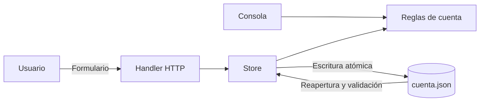

# prj_withdrawal · Cajero web en Go

[](https://github.com/Gabriel-XDDDD/prj_withdrawal/actions/workflows/tests.yml)
[](https://go.dev/)
[](features/)

Proyecto académico de **DSL / Gherkin-BDD** para la Universidad Nacional de Ingeniería. La aplicación permite retirar y abonar efectivo desde una interfaz web, conserva el saldo y registra cada intento en un historial JSON verificable.

**Repositorio:** <https://github.com/Gabriel-XDDDD/prj_withdrawal>  
**Informe:** [Informe de la entrega 3](docs/Informe_Entrega_3_actualizado.pdf)

## Funcionalidades

- Retiro en múltiplos de S/ 10.
- Abono positivo con hasta dos decimales.
- Rechazo por fondos insuficientes sin modificar el saldo.
- Registro de operaciones exitosas, fallidas y erróneas.
- Persistencia atómica en `cuenta.json` mediante archivo temporal y renombrado.
- Validación del saldo, identificadores, eventos y cronología UTC al reabrir.
- Interfaz web local y consola alternativa.
- Pruebas unitarias, concurrentes, HTTP y escenarios Gherkin.
- Integración continua con GitHub Actions.

## Evolución del proyecto

| Entrega | Incremento |
|---|---|
| 1 | Retiro y abono desde consola |
| 2 | Persistencia e integridad del saldo e historial JSON |
| 3 | Refactorización a aplicación web y automatización CI |

## Arquitectura



```text
prj_withdrawal/
├── account.go            reglas de retiro, abono y conversión a céntimos
├── store.go              persistencia e integridad del historial JSON
├── web.go                rutas GET / y POST /movimiento
├── index.html            formulario e historial web
├── main.go               servidor web y consola alternativa
├── *_test.go             pruebas de negocio, almacenamiento y HTTP
├── features/             escenarios Gherkin y pasos Behave
├── cuenta.json           estado inicial de demostración
└── .github/workflows/    integración continua
```

## Ejecutar en macOS

Requiere Go 1.20 o posterior:

```sh
git clone https://github.com/Gabriel-XDDDD/prj_withdrawal.git
cd prj_withdrawal
go run .
```

Abra <http://localhost:8080>. Para detener el servidor use `Control-C`.

Consola alternativa:

```sh
go run . -cli
```

Prueba aislada sin modificar `cuenta.json`:

```sh
go run . -nombre Alice -saldo 234.56 -retiro 200 -test exito
```

## Pruebas

```sh
go test -count=1 -v ./...
go test -race -count=1 ./...
go vet ./...
```

Escenarios Gherkin:

```sh
python3 -m venv .venv
source .venv/bin/activate
python -m pip install behave
python -m behave
```

La suite comprueba retiros, abonos, importes inválidos, fondos insuficientes, concurrencia, corrupción del JSON, fechas UTC, recuperación del saldo y formularios HTTP.

## Demostración esperada

Partiendo de S/ 234.56:

1. Retirar S/ 200.00 produce un saldo de S/ 34.56.
2. Abonar S/ 20.50 produce un saldo de S/ 55.06.
3. Abonar S/ 0 registra un error y conserva S/ 55.06.
4. Reiniciar el servidor recupera el saldo y el historial.

## Consideraciones

- Los valores monetarios se guardan en céntimos enteros.
- Use una sola instancia del programa por archivo `cuenta.json`.
- `cuenta.json` contiene el estado inicial. Para reiniciar la demostración, restaure su contenido desde Git.
- Es una aplicación académica local de una sola cuenta; no incorpora autenticación de clientes ni despliegue bancario real.

## Autor

Gabriel Eustaquio · Ingeniería de Software · UNI FIIS
